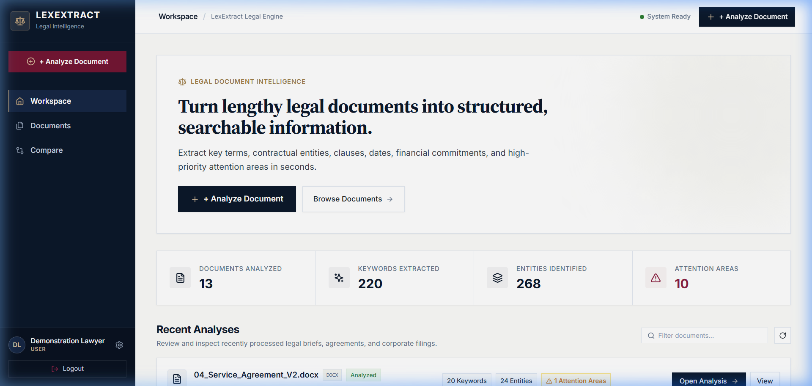
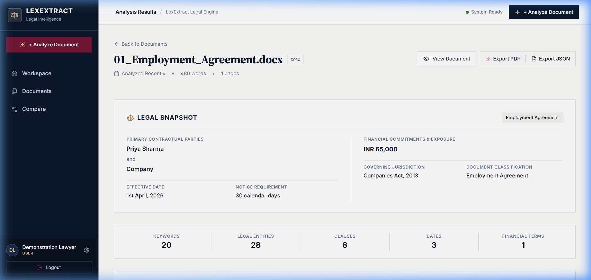
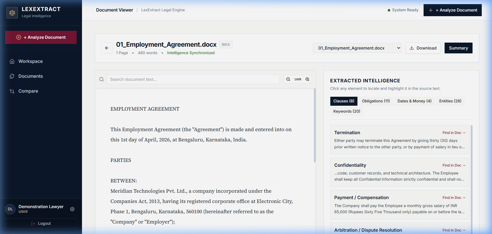
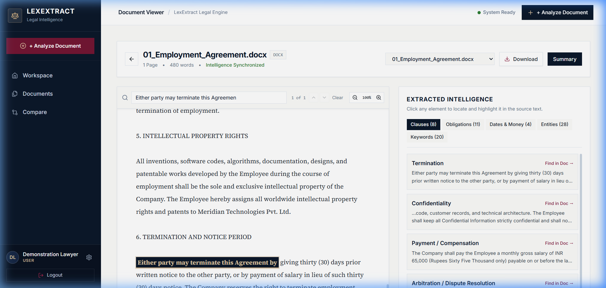
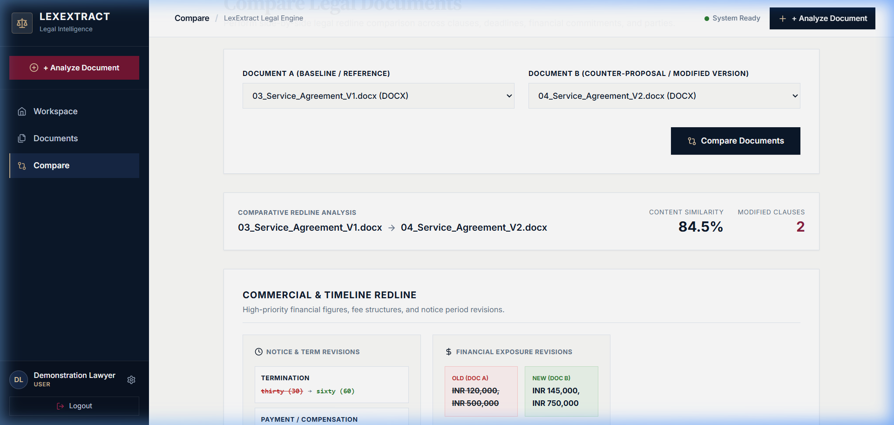
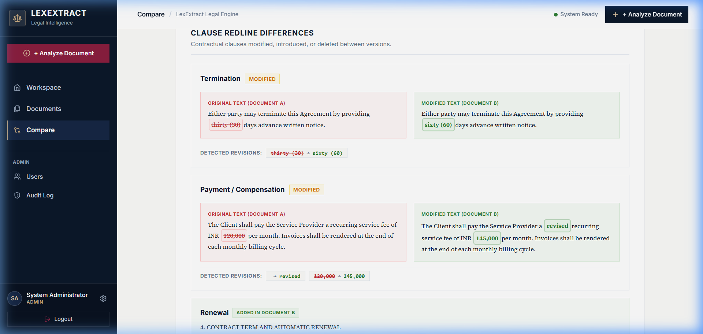
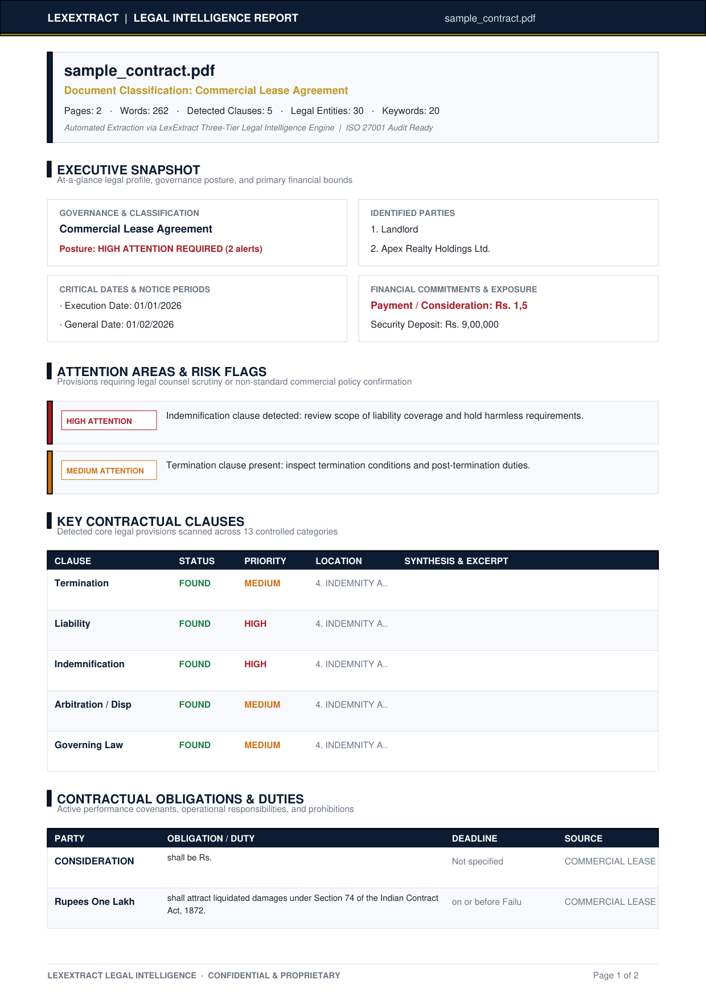
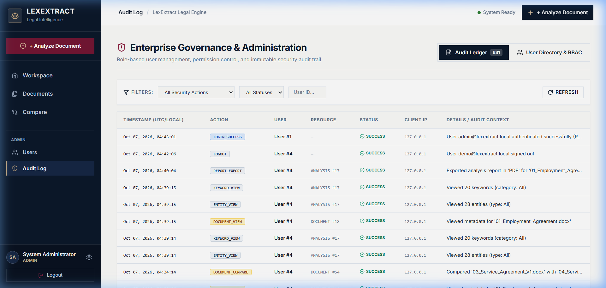

# LexExtract — Legal Document Keyword & Entity Extractor

**A Comprehensive Multi-Disciplinary Capstone Project Integrating:**
- **Enterprise Systems (ES):** Three-tier decoupled architecture, high-performance asynchronous FastAPI RESTful microservices, relational persistence (SQLAlchemy 2.0 ORM + SQLite/PostgreSQL), stateless RFC 7519 JWT authentication, Argon2id cryptographic password hashing, role-based access control (USER, ANALYST, ADMIN), tenant data isolation, and immutable governance audit logging.
- **Advanced Statistical & Text Mining Analysis (ASTMA):** Statutory-aware text preprocessing, n-gram candidate generation, Term Frequency-Inverse Document Frequency (TF-IDF), Rapid Automatic Keyword Extraction (RAKE) word co-occurrence graph scoring, domain-specific legal taxonomy matching, composite hybrid ranking, linguistic Named Entity Recognition (spaCy `en_core_web_sm`), deterministic legal gazetteer rules, cosine vector document comparison, and repeatable empirical benchmarking ($P, R, F_1$, Top-K cutoffs, ablation studies).
- **IT Project Management (ITPM):** Comprehensive 12-phase Work Breakdown Structure (WBS), IEEE 829 Test Plan and Test Cases, 10-point PMBOK Risk Register (R-01 to R-10), Requirements Traceability Matrix (RTM), 6-tier Quality Assurance Checklist, and empirical Requirement Coverage Reporting.

---

## 1. Problem Statement

Legal practitioners, corporate counsels, compliance officers, and judicial researchers face massive document overhead when reviewing voluminous commercial agreements, court judgments, statutory enactments, and legal notices. Manual contract review is slow, error-prone, and expensive.

Generic natural language processing (NLP) and off-the-shelf text search tools fail in the legal domain because:
1. **Specialized Syntax & Archaic Phrasing:** Legal texts employ intricate syntactic structures, formal terminology, and Latin phrases (`inter alia`, `force majeure`, `mutatis mutandis`) that standard language models misinterpret.
2. **Citation Destruction:** Aggressive default text normalizers strip punctuation and structural delimiters, corrupting statutory citations such as `Section 11(6)` or `Article 226(1)`.
3. **Entity Misclassification:** Generic NER systems lack judicial hierarchy awareness, misclassifying high courts and tribunals as generic corporations or locations.
4. **Black-Box Proprietary AI:** Modern cloud LLM tools operate as opaque, unverifiable "black boxes" that pose severe data confidentiality, compliance, and hallucination risks.

---

## 2. Objectives

- **Enterprise-Grade Engineering:** Deliver a decoupled, scalable Three-Tier Enterprise Architecture (React presentation tier, FastAPI business logic tier, and SQLAlchemy persistence tier).
- **Explainable Text Mining (ASTMA):** Implement transparent, deterministic mathematical algorithms (TF-IDF, RAKE graph scoring, cosine similarity, rule-based gazetteers) that do not depend on external paid AI APIs.
- **Empirical Evaluation & Benchmarking:** Measure real information retrieval performance (Precision, Recall, F1-score, Top-K cutoffs, ablation) against a curated gold-standard benchmark corpus.
- **High-Value Legal Intelligence:** Automate contract-at-a-glance summaries, important clause detection across 13 legal categories, contractual obligations and prohibitions, and structured facts extraction.
- **Enterprise Security & Governance:** Enforce multi-tier RBAC, tenant document isolation, and an immutable audit trail for compliance and institutional accountability.
- **Rigorous Project Quality (ITPM):** Maintain full requirements traceability from business needs to automated test cases, comprehensive risk management, and formal QA verification.

---

## 3. Key Features

1. **Multi-Format Document Intake:** Upload PDF, DOCX, and TXT legal documents with MIME validation, magic-byte inspection, and a 25 MB safety ceiling.
2. **Citation-Aware Legal Text Preprocessor:** Normalizes whitespace, repairs hyphenated line breaks, and strictly preserves statutory citations and section symbols.
3. **Tri-Model Keyword Extraction:** Combines TF-IDF corpus frequency weighting (35%), RAKE graph co-occurrence scoring (35%), and domain legal taxonomy matching (30%).
4. **Hybrid Legal Named Entity Recognition (NER):** Tags 13 specialized legal entity classes using statistical spaCy NER combined with deterministic gazetteers.
5. **Interactive Legal Document Viewer:** In-browser document inspection with color-coded, interactive keyword and entity highlighting overlays.
6. **Document At-a-Glance Dashboard:** Synthesizes document type, participating parties, monetary figures, key dates, detected clauses, and attention areas.
7. **Important Clause Finder:** Classifies clauses across 13 standard contractual categories (Termination, Confidentiality, Dispute Resolution, Governing Law, Indemnification, Liability, Payment, Force Majeure, IP, Non-Compete, Severability, Amendment, Entire Agreement).
8. **Obligations & Responsibilities Extractor:** Detects modal auxiliary verbs (`shall`, `must`, `agrees to`, `shall not`) to extract contractual obligations, responsible parties, deadlines, and prohibitions.
9. **Structured Facts & Metadata:** Automatically extracts and normalizes execution dates, expiry dates, payment windows, and multi-currency amounts (INR, USD, EUR, GBP).
10. **In-Document Semantic Search:** Fast keyword and phrase searching returning match counts, sentence offsets, and ranked contextual snippets.
11. **Two-Document Comparative Analysis:** Side-by-side contract comparison computing ASTMA TF-IDF cosine similarity, metadata differences, and clause-by-clause diffing (`UNCHANGED`, `MODIFIED`, `ADDED`, `REMOVED`).
12. **Executive Report Export (PDF & JSON):** Multi-page executive legal reports generated via PyMuPDF vector rendering and raw structured JSON export.
13. **ASTMA Benchmark Console:** Real-time empirical evaluation workspace executing benchmark runs against the 12-document gold-standard corpus with ablation tables and latency profiling.
14. **Institutional Governance Audit Trail:** Immutable audit ledger tracking logins, document uploads, deletions, and administrative actions with client IP logging.

---

## 4. Visual Application Showcase

| Screen / Feature | Description |
| :--- | :--- |
| **Workspace & Dashboard**<br> | High-level legal metrics, real-time contract filing repository, and centralized multi-document intake. |
| **Document Analysis Results**<br> | Automated Legal Snapshot synthesizing parties, monetary bounds, notice requirements, attention areas, and clauses. |
| **Document Viewer & Intelligence**<br> | Paper-surface reading pane alongside synchronized multi-category extracted intelligence stream. |
| **Source Grounding ("Find in Doc")**<br> | Strict bi-directional source grounding highlighting and scrolling to exact clauses, obligations, and dates. |
| **Document Comparison**<br> | Side-by-side contract analysis reporting TF-IDF similarity, modified clauses, and timeline changes. |
| **Visual Redline Diff**<br> | Word-level diffing displaying deleted terms in red strikethrough and inserted terms in bold green. |
| **Executive PDF Intelligence Report**<br> | Publication-grade vector PDF reports structured for rapid 30-to-60 second attorney scan. |
| **Enterprise Governance & RBAC**<br> | Immutable compliance audit ledger recording logins, document uploads, exports, and permission enforcement. |

---

## 5. System Architecture

LexExtract is built strictly on the **Three-Tier Enterprise Architecture**:

```
┌────────────────────────────────────────────────────────────────────────┐
│                   PRESENTATION TIER (Frontend)                         │
│  React 18  •  Vite  •  Vanilla CSS Design System  •  Lucide Icons     │
│  Pages: Dashboard, Viewer, Analysis, Explorer, Benchmark, Audit       │
└───────────────────────────────────┬────────────────────────────────────┘
                                    │ HTTPS / RESTful JSON / Bearer JWT
                                    ▼
┌────────────────────────────────────────────────────────────────────────┐
│                    APPLICATION TIER (FastAPI)                          │
│  FastAPI  •  Uvicorn ASGI  •  Pydantic v2  •  PyJWT  •  Argon2id       │
│  ├── Security & RBAC Middleware (USER, ANALYST, ADMIN)                 │
│  ├── Document Ingestion Engine (PyMuPDF / python-docx)                 │
│  ├── Text Preprocessing & Statutory Citation Normalizer               │
│  ├── Hybrid Keyword Scorer (TF-IDF + RAKE + Legal Lexicon)             │
│  ├── Hybrid Entity Recognizer (spaCy + Legal Gazetteers)               │
│  ├── Legal Intelligence (Clauses, Obligations, Facts, Compare)        │
│  ├── Report Generator (PyMuPDF Vector PDF + Structured JSON)           │
│  ├── ASTMA Empirical Evaluation Runner (P, R, F1, Top-K, Ablation)    │
│  └── Immutable Governance Audit Logger                                 │
└───────────────────────────────────┬────────────────────────────────────┘
                                    │ SQLAlchemy 2.0 ORM
                                    ▼
┌────────────────────────────────────────────────────────────────────────┐
│                      DATA TIER (Persistence)                           │
│  SQLAlchemy ORM  •  SQLite (Academic/Dev) / PostgreSQL (Enterprise)   │
│  Tables: users, documents, analysis_runs, keywords, entities, audit    │
│  Local File System: Secure hashed document storage                     │
└────────────────────────────────────────────────────────────────────────┘
```

---

## 6. Technology Stack

| Architecture Tier | Technology | Purpose / Application |
| :--- | :--- | :--- |
| **Presentation Tier** | **React 18** | Modular component-based user interface |
| | **Vite v5** | High-performance frontend build tool and dev server |
| | **Vanilla CSS** | Tailored legal-tech dark slate design system |
| | **Lucide React** | Consistent iconography |
| **Application Tier** | **FastAPI** | Asynchronous Python REST API framework |
| | **Uvicorn** | High-throughput ASGI production server |
| | **Pydantic v2** | Request/response data validation and serialization |
| | **PyJWT** | Stateless RFC 7519 JSON Web Token authentication |
| | **pwdlib[argon2]** | Argon2id cryptographic password hashing |
| **NLP & Text Mining** | **scikit-learn** | TfidfVectorizer for cross-document keyword scoring |
| | **In-House RAKE** | Graph word co-occurrence scoring |
| | **spaCy (`en_core_web_sm`)** | Tokenization, lemmatization, and POS tagging |
| | **Custom Gazetteers** | Rule-based legal entities, courts, and acts |
| | **PyMuPDF (`pymupdf`)** | PDF text extraction and multi-page vector PDF generation |
| | **python-docx** | Microsoft Word DOCX document parsing |
| **Data Tier** | **SQLAlchemy 2.0** | Relational ORM mapping with foreign-key constraints |
| | **SQLite / PostgreSQL** | ACID-compliant relational persistence |
| **Testing & Quality** | **Pytest** | Automated unit, integration, and edge-case testing (119 tests) |

---

## 7. Academic Core Concepts Mapping

### 6.1 Enterprise Systems (ES) Concepts
- **Three-Tier Decoupled Architecture:** Clean separation of concerns between presentation, business logic, and data storage.
- **Enterprise Security & Cryptography:** Passwords hashed with memory-hard Argon2id; authentication managed via stateless JWT tokens with role claims.
- **Multi-Role RBAC:** Differentiated privileges for standard users (`USER`), data analysts (`ANALYST`), and compliance administrators (`ADMIN`).
- **Tenant Data Isolation:** Enforced via backend dependency checks (`check_document_access`) blocking cross-user access with HTTP 403 Forbidden.
- **Governance Audit Trail:** Immutable system ledger tracking all critical transactions for corporate accountability.

### 6.2 Advanced Statistical & Text Mining Analysis (ASTMA) Concepts
- **Term Frequency-Inverse Document Frequency (TF-IDF):** Penalizes generic legal stop words while elevating discriminative contractual terminology.
- **Rapid Automatic Keyword Extraction (RAKE):** Computes word degree to word frequency ratios ($deg(w)/freq(w)$) over co-occurrence graphs.
- **Information Retrieval Metrics:** Evaluates Precision, Recall, and F1-score across Micro and Macro aggregation.
- **Top-K Retrieval Cutoffs:** Analyzes precision degradation at $K=5$, $K=10$, and $K=20$.
- **Ablation Studies:** Isolates component performance (TF-IDF vs RAKE vs Hybrid).
- **Vector Cosine Similarity:** Computes multi-dimensional angle between document TF-IDF vectors to quantify document resemblance.

### 6.3 IT Project Management (ITPM) Concepts
- **Work Breakdown Structure (WBS):** 100% rule hierarchical decomposition spanning 12 project phases (`docs/WBS.md`).
- **Milestone Schedule:** Iterative phased lifecycle tracking deliverables on the critical path (`docs/PROJECT_TIMELINE.md`).
- **PMBOK Risk Management:** Formal 10-point Risk Register (R-01 to R-10) with severity scoring, mitigations, and contingencies (`docs/RISK_REGISTER.md`).
- **Requirements Traceability Matrix (RTM):** Bidirectional mapping from functional requirements to code modules and test cases (`docs/REQUIREMENTS_TRACEABILITY_MATRIX.md`).
- **IEEE 829 Software Testing:** Comprehensive test plan and test case specifications (`docs/TEST_PLAN.md`, `docs/TEST_CASES.md`).
- **Empirical Coverage Verification:** Exact mathematical reporting of requirement and test coverage (`docs/REQUIREMENT_COVERAGE_REPORT.md`).

---

## 8. Installation & Setup

### Prerequisites
- Python 3.10+ (Tested on Python 3.12 / 3.14)
- Node.js 18+ and npm
- Git

### 1. Clone the Repository
```bash
git clone https://github.com/Tejas190605/LexExtract.git
cd LexExtract
```

### 2. Backend Setup
```bash
cd backend
python -m venv .venv
# On Windows (PowerShell):
.\.venv\Scripts\Activate.ps1
# On Windows (CMD):
.\.venv\Scripts\activate.bat
# On Linux / macOS:
source .venv/bin/activate

pip install -r requirements.txt
python -m spacy download en_core_web_sm
```

### 3. Frontend Setup
```bash
cd ../frontend
npm install
```

---

## 9. Live Public Cloud Deployment (Render Free Tier)

LexExtract is deployed and publicly accessible online for academic evaluation without requiring local environment configuration.

| Service Tier | Public URL | Operational Status |
| :--- | :--- | :--- |
| **Frontend Web Application** | **[https://lexextract-frontend.onrender.com](https://lexextract-frontend.onrender.com)** | **ONLINE / 200 OK** (Global CDN) |
| **Backend API Gateway** | **[https://lexextract-backend.onrender.com](https://lexextract-backend.onrender.com)** | **HEALTHY / 200 OK** |
| **Backend Health Probe** | **[https://lexextract-backend.onrender.com/health](https://lexextract-backend.onrender.com/health)** | **HEALTHY** (`database: connected`) |
| **Interactive OpenAPI Docs** | **[https://lexextract-backend.onrender.com/docs](https://lexextract-backend.onrender.com/docs)** | **ONLINE** (Swagger UI) |

### Demonstration Credentials (1-Click Login Available)

The live application provides one-click quick-fill credential buttons on the login portal:

| Role | Email / Identifier | Password | Access Privileges |
| :--- | :--- | :--- | :--- |
| **Lawyer (USER)** | `demo@lexextract.local` | `User@Lex2026!` | Document upload (.pdf, .docx), legal analysis, clause/entity discovery, search, diff comparison, PDF/JSON export |
| **Compliance Admin (ADMIN)** | `admin@lexextract.local` | `Admin@Lex2026!` | All user capabilities + Enterprise Audit Ledger & User Directory |
| **Legal Analyst (ANALYST)** | `analyst@lexextract.local` | `Analyst@Lex2026!` | Advanced intelligence workflows & ASTMA empirical benchmark console |

### Verified Live Deployment Verification Matrix

| Verification Checkpoint | Live Endpoint Tested | Result | Observations |
| :--- | :--- | :---: | :--- |
| **1. Operational Health Probe** | `GET /health` | **PASS** | Status `healthy`, Database `connected`, Environment `production`. |
| **2. API Metadata & Swagger** | `GET /api/v1/`, `GET /docs` | **PASS** | 200 OK, full OpenAPI specification served. |
| **3. RBAC Authentication** | `POST /api/v1/auth/login` | **PASS** | Verified JWT issuance for USER, ANALYST, and ADMIN roles. |
| **4. PDF Document Upload** | `POST /api/v1/documents/upload` | **PASS** | Ingested `sample_contract.pdf`, parsed 2 pages, 262 words. |
| **5. DOCX Document Upload** | `POST /api/v1/documents/upload` | **PASS** | Ingested `01_Employment_Agreement.docx`, parsed 480 words. |
| **6. Legal Text Extraction** | `GET /api/v1/documents/{id}/text` | **PASS** | Extracted full text stream & structured page offsets. |
| **7. Keyword Extraction** | `GET /api/v1/analyses/{id}/keywords`| **PASS** | Ranked legal terms (e.g., Intellectual Property, Termination). |
| **8. Entity Extraction (NER)** | `GET /api/v1/analyses/{id}/entities`| **PASS** | Extracted Parties, Jurisdiction, Dates, and Monetary bounds. |
| **9. In-Document Search** | `GET /api/v1/documents/{id}/search` | **PASS** | Highlighted sentence offsets and match context for queries. |
| **10. Document Comparison** | `POST /api/v1/documents/compare` | **PASS** | Generated ASTMA TF-IDF similarity score & clause differences. |
| **11. Report Export (JSON)** | `GET /api/v1/analyses/{id}/export?format=json` | **PASS** | Valid structured JSON intelligence report download. |
| **12. Report Export (PDF)** | `GET /api/v1/analyses/{id}/export?format=pdf` | **PASS** | Valid vector PDF document dossier stream. |
| **13. Administrative Isolation** | `GET /api/v1/users/` | **PASS** | Non-admin practitioners blocked (HTTP 403 Forbidden). |
| **14. Governance Audit Trail**| `GET /api/v1/admin/audit-logs` | **PASS** | Immutable audit events recorded with client IP tracking. |
| **15. Responsive Layout** | Desktop & Mobile Viewports | **PASS** | Tested at 1280x800 and 375x812 with clean responsive layout. |

### Free-Tier Operating Characteristics & Storage Notice

1. **Cold Starts**: Render free Web Services spin down after 15 minutes of inactivity. When accessed after sleep, the first request will take ~30–50 seconds to wake up the backend container.
2. **Ephemeral Disk**: Uploaded files and database alterations persist during instance runtime. On restart or new deployment, the startup lifespan auto-seeder repopulates default accounts and baseline records immediately.
3. **Zero Billing**: Deployed strictly on free compute and static tiers with no billing or paid services enabled.

---

## 10. Running Locally

### Start Backend Server
```bash
cd backend
python -m uvicorn main:app --host 127.0.0.1 --port 8000 --reload
```
- API Base URL: `http://127.0.0.1:8000`
- Interactive OpenAPI Docs (Swagger UI): `http://127.0.0.1:8000/docs`
- Health Check Probe: `http://127.0.0.1:8000/health`

### Start Frontend Dev Server
```bash
cd frontend
npm run dev
```
- Web Application: `http://localhost:5173` (or `http://localhost:5174`)

---

## 10. Automated Testing & Verification

Run the full automated test suite containing 119 unit, integration, and edge-case tests:

```bash
cd backend
python -m pytest
```

Run test suite with detailed verbose output:
```bash
python -m pytest -v
```

Run edge-case test suite specifically:
```bash
python -m pytest tests/test_phase12_quality_edge_cases.py -v
```

---

## 11. ASTMA Evaluation Benchmark

Execute the empirical evaluation runner across the 12-document curated benchmark corpus:

```bash
cd backend
python -m app.services.evaluation_service
```

Alternatively, log in to the web interface and navigate to the **ASTMA Benchmark** tab to run evaluations interactively with visual scorecards, ablation tables, and latency meters.

---

## 12. Known Limitations

1. **Scanned Image Documents:** LexExtract processes computer-readable text streams. Scanned raster images require pre-processing with external OCR tools (e.g., Tesseract) before ingestion.
2. **Deterministic Architecture:** The system deliberately avoids external paid LLM APIs to maintain strict confidentiality, local reproducibility, and zero-cloud dependence.
3. **Corpus Scale:** The evaluation corpus comprises 12 carefully annotated representative legal contracts and court judgments, providing academic validation rather than industrial scale.

---

## 13. Legal Disclaimer

> **IMPORTANT NOTICE:**  
> **LexExtract is an academic document analysis and information retrieval platform created solely for educational and research purposes as part of an engineering capstone project. LexExtract does NOT provide legal advice, legal opinions, or binding contract review. The outputs, scores, extracted entities, and comparisons generated by the system are assistive heuristics and should NEVER replace professional review by a licensed attorney or qualified legal counsel.**
