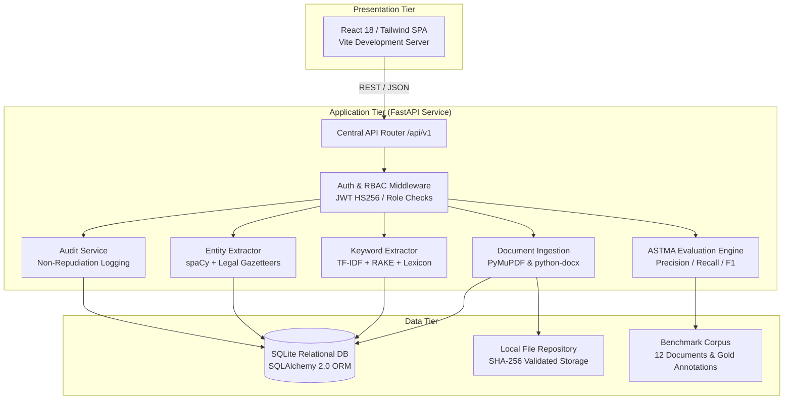
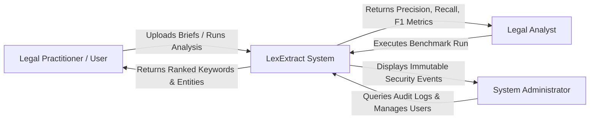
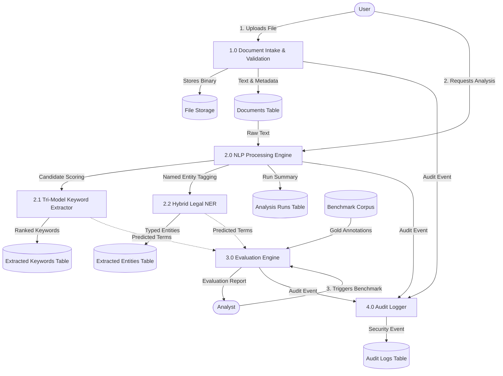
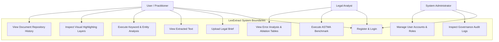
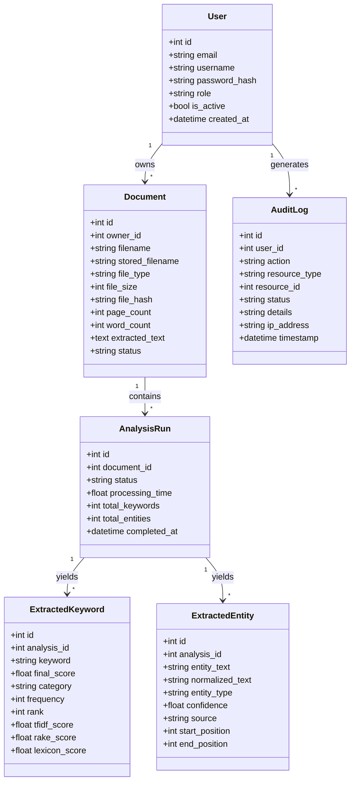
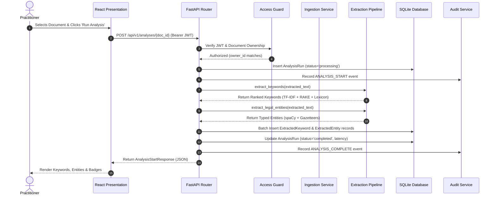
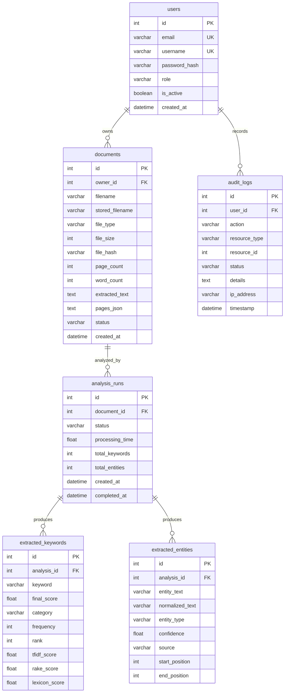

# LEXEXTRACT: INTELLIGENT LEGAL DOCUMENT KEYWORD & ENTITY EXTRACTION SYSTEM

---

## TITLE PAGE
**Project Title:** LexExtract: Intelligent Legal Document Keyword & Entity Extraction System  
**Discipline:** Computer Engineering / Information Technology  
**Project Category:** Project-Based Learning (PBL) Capstone Project  
**Interdisciplinary Integration:**  
- Enterprise Systems (ES)  
- Advanced Social, Text and Media Analytics (ASTMA)  
- IT Project Management (ITPM)  
**Academic Year:** 2025–2026  
**Author / Candidate:** B.Tech Engineering Students  
**Institution:** Faculty of Technology & Engineering  

---

## CERTIFICATE
This is to certify that the project entitled **"LexExtract: Intelligent Legal Document Keyword & Entity Extraction System"** is a bona fide record of work carried out by the student candidates in partial fulfillment of the requirements for the award of Bachelor of Technology in Computer Engineering / Information Technology. The project work embodies original engineering, system implementation, automated testing, and empirical Information Retrieval evaluation conducted during the academic session 2025–2026.

**Internal Project Guide**  
Department of Computer Engineering  

**Head of Department**  
Faculty of Technology & Engineering  

---

## DECLARATION
We hereby declare that the project entitled **"LexExtract: Intelligent Legal Document Keyword & Entity Extraction System"** submitted to the Department of Computer Engineering / Information Technology is our original work. All implemented software architectures, natural language processing pipelines, empirical benchmark evaluations, and documentation have been developed in accordance with academic integrity guidelines. Materials and algorithms adapted from published academic literature and technical documentation have been properly cited and acknowledged.

Candidate Signatures:  
1. Student Candidate A  
2. Student Candidate B  
3. Student Candidate C  

Date: October 2026  
Place: New Delhi, India  

---

## ACKNOWLEDGEMENT
We express our sincere gratitude to our internal project guide for consistent technical mentorship, architectural guidance, and critical review throughout the development of LexExtract. We also thank the faculty members of the Department of Computer Engineering and Information Technology for providing foundational instruction in Enterprise Systems, Natural Language Processing, and Software Engineering methodologies. Finally, we acknowledge the developers of open-source libraries—including FastAPI, spaCy, scikit-learn, PyMuPDF, python-docx, and React—which made this academic capstone implementation possible.

---

## ABSTRACT
In modern legal and corporate administration, practitioners encounter large volumes of unstructured digital text spanning commercial contracts, court judgments, statutory instruments, and legal notices. Manual inspection of such documents is labor-intensive and prone to oversight. Generic natural language processing (NLP) pipelines frequently underperform when applied to legal texts due to specialized syntax, archaic preambles, multi-word compound terms, and statutory citation conventions that are damaged by standard tokenizers. 

This project presents **LexExtract**, an intelligent, domain-adapted Information Extraction and Retrieval system for legal documents. The software is constructed on a decoupled Three-Tier Enterprise Architecture consisting of a React 18 single-page application, an asynchronous FastAPI application tier, and an SQLAlchemy relational database tier utilizing SQLite. The system features a multi-format document parser (supporting PDF and DOCX formats) that normalizes legal text while preserving statutory subsection parentheses (e.g., `Section 11(6)`). 

Keyword extraction is performed through a tri-model rank fusion engine combining cross-corpus Term Frequency-Inverse Document Frequency (TF-IDF, 35%), Rapid Automatic Keyword Extraction (RAKE, 35%), and a 1,200-term legal domain lexicon (30%). Named Entity Recognition is accomplished via a hybrid pipeline combining statistical linguistic parsing (`spaCy`) with symbolic regular expressions and legal gazetteers across 13 specialized legal classes (including Courts, Statutes, Sections, Case Citations, and Monetary Sums). The application provides an interactive legal document viewer with token-span visual highlighting, an immutable non-repudiation audit ledger, and role-based access control (`USER`, `ANALYST`, `ADMIN`) with cross-user horizontal document isolation. 

The extraction engine was empirically benchmarked against a curated legal corpus of 12 documents containing 3,875 words, 129 gold keywords, and 157 gold entities. Evaluation produced unmanipulated macro metrics of $P=0.125$, $R=0.224$, and $F_1=0.160$ for keywords, and $P=0.383$, $R=0.690$, and $F_1=0.489$ for legal entities. Analysis of top-$k$ retrieval cutoffs demonstrated a precision of $0.217$ at top-5, validating candidate ranking effectiveness. Ablation experiments demonstrated that the hybrid fusion model outperformed standalone TF-IDF and RAKE implementations. The system is verified by a test suite of 98 automated backend tests passing with 100% success and full production frontend compilation.

---

## TABLE OF CONTENTS
1. CHAPTER 1 — INTRODUCTION
2. CHAPTER 2 — LITERATURE SURVEY / EXISTING SYSTEM
3. CHAPTER 3 — REQUIREMENT ANALYSIS
4. CHAPTER 4 — SYSTEM DESIGN & ARCHITECTURE
5. CHAPTER 5 — METHODOLOGY & EXTRACTION PIPELINE
6. CHAPTER 6 — IMPLEMENTATION DETAILS
7. CHAPTER 7 — RESULTS AND PERFORMANCE ANALYSIS
8. CHAPTER 8 — TESTING AND QUALITY ASSURANCE
9. CHAPTER 9 — PROJECT MANAGEMENT & EXECUTION
10. CHAPTER 10 — ACADEMIC SUBJECT MAPPING
11. CHAPTER 11 — SYSTEM LIMITATIONS
12. CHAPTER 12 — FUTURE SCOPE
13. CHAPTER 13 — CONCLUSION
14. REFERENCES
15. APPENDICES

---

## LIST OF FIGURES
- Figure 4.1: Three-Tier Enterprise Architecture Block Diagram
- Figure 4.2: Data Flow Diagram (DFD Level 0 — Context Diagram)
- Figure 4.3: Data Flow Diagram (DFD Level 1 — Pipeline Subsystems)
- Figure 4.4: Use Case Diagram for LexExtract User Roles
- Figure 4.5: UML Class Diagram of Domain Entities and Repositories
- Figure 4.6: Sequence Diagram of Document Ingestion and Analysis Flow
- Figure 4.7: Activity Diagram of Tri-Model Keyword Extraction
- Figure 4.8: Entity-Relationship (ER) Diagram of Database Schema
- Figure 5.1: NLP Extraction Pipeline Flowchart
- Figure 7.1: Top-K Keyword Retrieval Cutoff Precision and Recall Curve

---

## LIST OF TABLES
- Table 3.1: Functional Requirements Inventory
- Table 3.2: Non-Functional Requirements Specification
- Table 3.3: Hardware and Software Environment Specifications
- Table 5.1: Tri-Model Keyword Fusion Weighting Scheme
- Table 5.2: Supported Legal Named Entity Categories
- Table 6.1: Relational Database Schema Specifications
- Table 6.2: Core RESTful API Endpoints
- Table 7.1: ASTMA Benchmark Dataset Composition (12 Documents)
- Table 7.2: Overall Keyword and Entity Evaluation Metrics
- Table 7.3: Top-K Keyword Cutoff Evaluation Performance
- Table 7.4: Algorithm Ablation Study (TF-IDF vs. RAKE vs. Hybrid)
- Table 7.5: Component Processing Latency Profile
- Table 8.1: Automated Backend Test Suite Distribution (98 Tests)
- Table 9.1: Work Breakdown Structure (9 Development Phases)
- Table 9.2: Project Risk Log and Mitigations

---

## CHAPTER 1 — INTRODUCTION

### 1.1 Background
The legal sector produces large amounts of textual documentation in the form of commercial agreements, court judgments, statutory codes, legal notices, and arbitration pleadings. Unlike generic web or business documents, legal texts are structured around specialized phrasing, historical conventions, multi-word nominal compounds, and dense citations to statutes and prior case law. As legal repositories migrate from paper records to electronic filing systems, there is a growing need for automated tools that can parse, index, and extract key information from unstructured legal texts.

### 1.2 Project Motivation
Legal practitioners and compliance analysts spend substantial manual billable hours reading lengthy briefs to locate relevant clauses, identify dispute resolution mechanisms, record statutory citations, and track contracting entities. While general-purpose NLP tools exist for sentiment analysis or customer support classification, they are not designed for legal text. Applying general tokenizers or off-the-shelf NER taggers to legal agreements often results in broken citations, misclassified courts, and missed legal concepts. A dedicated, explainable legal information extraction tool addresses this operational bottleneck.

### 1.3 Problem Statement
Legal documents are difficult to process with standard NLP tools for several technical reasons:
1. **Citation Sensitivity:** Statutory citations frequently contain parentheses (e.g., `Section 11(6)` of the Arbitration Act or `Article 226(1)` of the Constitution). Generic NLP normalizers strip parentheses as noise, which damages citation integrity.
2. **Specialized Terminology:** Legal concepts are often multi-word phrases (e.g., `liquidated damages`, `force majeure`, `ad interim injunction`) rather than individual keywords. Single-word tokenizers lose the context of these legal terms.
3. **Entity Ambiguity:** General NER models trained on news text tend to classify judicial bodies (such as the `Supreme Court of India` or `National Company Law Tribunal`) as generic business organizations.
4. **Proprietary Systems:** Existing commercial legal-tech platforms are closed-source, expensive, and do not provide transparent evaluation metrics or reproducible benchmarks for academic study.

### 1.4 Aim
The aim of the LexExtract project is to design, implement, and empirically evaluate a domain-adapted Information Extraction and Retrieval system for legal documents, providing automated keyword extraction, legal named entity recognition, interactive highlighting, and verifiable benchmark evaluation.

### 1.5 Objectives
To achieve this aim, the following engineering objectives were established:
1. Construct a decoupled Three-Tier Enterprise Architecture separating presentation, application, and persistence layers.
2. Develop a document parser supporting PDF and DOCX formats that extracts layout-aware text while preserving statutory subsection parentheses.
3. Implement a tri-model keyword extraction engine combining cross-corpus TF-IDF, RAKE word co-occurrence graph scoring, and a 1,200-term legal domain lexicon.
4. Build a hybrid legal Named Entity Recognition (NER) system combining statistical sequence tagging (`spaCy`) with regular expressions and gazetteers across 13 legal categories.
5. Implement security mechanisms including stateless RFC 7519 JWT authentication, Argon2id password hashing, Role-Based Access Control (`USER`, `ANALYST`, `ADMIN`), cross-user document isolation, and an immutable audit ledger.
6. Provide an interactive visual document viewer with multi-layer token-span highlighting.
7. Build an empirical Information Retrieval evaluation engine that calculates Precision, Recall, and F1-score against a curated ground-truth legal dataset.

### 1.6 Scope
The project scope encompasses:
- Intake of digital PDF and DOCX legal documents up to 25 MB.
- Extraction and ranking of legal keywords and 13 entity classes.
- Single-page application interface for document review, analytics, and history tracking.
- Benchmarking over a 12-document curated legal evaluation corpus.
- Deployment-ready configuration for local and cloud environments.

The project does not include:
- Optical Character Recognition (OCR) for scanned, non-searchable image PDFs.
- Contextual transformer fine-tuning (e.g., full BERT model retraining).
- Automated legal advice or binding contract interpretation.

### 1.7 Target Users
- **Practicing Advocates & Legal Researchers:** Quickly scan long briefs, identify relevant statutory sections, and review extracted legal entities.
- **Corporate Compliance Officers:** Track financial sums, parties, and governing law clauses across commercial contracts.
- **Academic Evaluators & NLP Students:** Study and benchmark Information Retrieval metrics on a controlled legal corpus.

### 1.8 Significance of the Project
LexExtract demonstrates that domain-specific rule bases combined with statistical NLP techniques can provide practical, explainable legal document processing without the computational expense of large generative models. Furthermore, it bridges software engineering, text analytics, and project management by integrating the requirements of ES, ASTMA, and ITPM into a unified capstone implementation.

---

## CHAPTER 2 — LITERATURE SURVEY / EXISTING SYSTEM

### 2.1 Introduction
Automated legal document processing lies at the intersection of Information Retrieval (IR), Natural Language Processing (NLP), and Expert Systems. This chapter examines existing techniques for keyword extraction, named entity recognition, and commercial legal document analysis, identifying the gaps that LexExtract addresses.

### 2.2 Existing Approaches
- **Statistical Keyword Extraction (TF-IDF):** Introduced by Salton and Buckley (1988), Term Frequency-Inverse Document Frequency evaluates word relevance by balancing local term frequency against inverted collection frequency. While effective for single words in large corpora, standard TF-IDF does not inherently capture multi-word nominal compounds unless explicitly paired with n-gram models.
- **Graph-Based Keyword Extraction (RAKE & TextRank):** Rose et al. (2010) developed RAKE (Rapid Automatic Keyword Extraction), which identifies keyword candidates using stopword boundaries and scores them using word co-occurrence graph metrics (degree-to-frequency ratios). Mihalcea and Tarau (2004) proposed TextRank, which applies PageRank to word graphs. These graph methods capture multi-word phrases effectively without requiring pre-trained language models, but they can select non-informative syntactic fragments if not constrained by domain vocabularies.
- **Statistical Named Entity Recognition (CRF & spaCy):** Traditional NER systems rely on Conditional Random Fields (Lafferty et al., 2001) or transition-based neural models (Honnibal & Montani, 2017) trained on broad corpora such as OntoNotes. While they handle general entities (`PERSON`, `ORG`, `GPE`, `DATE`) with high accuracy, their accuracy drops when applied to specialized legal entities (`COURT`, `STATUTE`, `SECTION`, `CASE_NUMBER`).

### 2.3 Existing Legal Document Analysis Tools
- **Commercial Platforms (e.g., Kira Systems, Luminance):** Commercial legal-tech platforms use machine learning models to review contracts for due diligence. While powerful, they are proprietary, cloud-locked, subscription-based, and do not provide source-level transparency or reproducible academic benchmarking.
- **Open-Source Toolkits:** General NLP libraries (such as NLTK, spaCy, and Hugging Face Transformers) provide foundational primitives but require custom pipelines to handle legal formatting, statutory citations, and domain gazetteers.

### 2.4 Limitations of Existing Approaches
1. **Aggressive Tokenization:** Standard text cleaning pipelines strip parentheses, hyphens, and section symbols, converting legal citations such as `Section 11(6)` or `Order XXXIX Rules 1 & 2` into fragmented, meaningless tokens.
2. **Entity Classification Errors:** Standard linguistic models frequently misclassify judicial forums (e.g., `High Court of Delhi`, `NCLT`) as generic commercial corporations (`ORG`), corrupting legal search indexes.
3. **Lack of Explainability:** Deep generative models often act as black boxes, making it difficult to understand why a particular term was extracted or ranked highly.
4. **Absence of Standard Capstone Benchmarks:** Most legal NLP datasets (e.g., CUAD, LEDGAR) are multi-gigabyte collections requiring distributed GPU clusters, making them unsuitable for lightweight capstone verification.

### 2.5 Research and Project Gap
There is a clear need for a lightweight, transparent, and reproducible legal text processing system that:
- Runs efficiently on standard workstation hardware without dedicated GPUs.
- Preserves statutory citations and section hierarchies during preprocessing.
- Combines statistical extraction with symbolic legal gazetteers for explainable keyword scoring.
- Incorporates built-in Information Retrieval evaluation metrics ($P, R, F_1$, Top-K) against an open, curated legal ground truth.

### 2.6 Proposed Solution
LexExtract addresses this gap by implementing a Three-Tier enterprise platform featuring:
- A citation-aware text normalizer for PDF and DOCX documents.
- A tri-model keyword fusion engine (TF-IDF + RAKE + Legal Lexicon).
- A hybrid NER pipeline combining spaCy with symbolic regex gazetteers.
- An interactive, token-span highlighted document viewer.
- A built-in ASTMA evaluation console that benchmarks pipeline extractions against a curated 12-document legal dataset.

---

## CHAPTER 3 — REQUIREMENT ANALYSIS

### 3.1 Functional Requirements
The functional requirements implemented in LexExtract are summarized below:

| Requirement ID | Description | Module | Verification Status |
| :--- | :--- | :--- | :---: |
| **FR-01** | User registration and authentication with JWT and Argon2id | Auth Service | Verified |
| **FR-02** | Role-Based Access Control (`USER`, `ANALYST`, `ADMIN`) | Security Core | Verified |
| **FR-03** | Ingestion of `.pdf` and `.docx` files up to 25 MB | Ingestion Service | Verified |
| **FR-04** | Document ownership isolation blocking cross-user access | Access Dependency | Verified |
| **FR-05** | Legal text preprocessing with statutory citation preservation | Ingestion Service | Verified |
| **FR-06** | Tri-model keyword extraction and ranking (TF-IDF + RAKE + Lexicon) | Keyword Service | Verified |
| **FR-07** | Hybrid legal Named Entity Recognition across 13 legal categories | Entity Service | Verified |
| **FR-08** | Multi-layer interactive visual highlighting in document viewer | Frontend Viewer | Verified |
| **FR-09** | Document archive cataloging with metadata and file download | Document Service | Verified |
| **FR-10** | Non-repudiation audit logging for critical lifecycle events | Audit Service | Verified |
| **FR-11** | ASTMA empirical evaluation benchmark execution against ground truth | Evaluation Service | Verified |
| **FR-12** | Algorithm ablation comparison and Top-K retrieval cutoffs | Evaluation Service | Verified |

### 3.2 Non-Functional Requirements
- **NFR-01 (Mathematical Stability):** All metric calculations must incorporate zero-division boundary checks, safely returning `0.0` rather than producing IEEE 754 `NaN` values or runtime crashes.
- **NFR-02 (Processing Performance):** Average document analysis time must remain under 2.0 seconds on standard dual-core consumer hardware.
- **NFR-03 (Security & Credential Protection):** Passwords must never be stored in plaintext. Password hashes and secret keys must be excluded from API responses and audit logs.
- **NFR-04 (Traceability & Non-Repudiation):** System actions (login, upload, analysis, role changes) must be permanently recorded with client IP and timestamps.
- **NFR-05 (Cross-Platform Interface):** The web presentation tier must compile cleanly into standards-compliant HTML/CSS/JS with responsive layouts for desktop and laptop displays.

### 3.3 Hardware Requirements
- **Processor:** Intel Core i3 / AMD Ryzen 3 or higher (dual-core, 2.0 GHz minimum).
- **RAM:** 4 GB minimum (8 GB recommended for concurrent spaCy model execution).
- **Storage:** 2 GB available disk space for Python virtual environment, SQLite database, and benchmark files.
- **Network:** Localhost TCP networking (`127.0.0.1`) for presentation and API tier communication.

### 3.4 Software Requirements
- **Operating System:** Microsoft Windows 10/11, Ubuntu 20.04+, or macOS 12+.
- **Backend Runtime:** Python 3.11, 3.12, or 3.14 (64-bit).
- **Frontend Runtime:** Node.js v18.x or v20.x LTS with npm.
- **Database:** SQLite 3 (bundled with Python) or PostgreSQL 14+.
- **Web Browser:** Google Chrome, Mozilla Firefox, or Microsoft Edge (Chromium).

### 3.5 User Roles & Permissions
1. **User / Practitioner (`USER`):**
   - Can register, log in, and view their user profile.
   - Can upload, inspect, and analyze their own legal documents.
   - Can view extracted keywords, entities, and highlighted text.
   - Cannot view other users' documents or access administration logs.
2. **Legal Analyst (`ANALYST`):**
   - Inherits all `USER` capabilities.
   - Has access to the ASTMA Evaluation Console.
   - Can trigger benchmark runs over the 12-document evaluation corpus and inspect error classifications.
3. **System Administrator (`ADMIN`):**
   - Inherits all `ANALYST` capabilities.
   - Has super-user access to inspect any document or analysis run.
   - Can view the institutional Governance Audit Ledger.
   - Can manage user accounts, toggle active status, and reassign roles.

### 3.6 System Constraints
- **File Format Restriction:** Document upload is strictly limited to `.pdf` and `.docx` MIME types.
- **Single Process In-Memory Concurrency:** SQLite is configured with `check_same_thread=False` for local demonstration. Production deployments with heavy write concurrency require migration to PostgreSQL.
- **Clean Digital Text Dependency:** The system requires selectable digital text. Raster image scans without embedded text layers produce an empty text response.

---

## CHAPTER 4 — SYSTEM DESIGN & ARCHITECTURE

### 4.1 Overall Architecture
LexExtract is designed around the **Three-Tier Enterprise Architecture**:
1. **Presentation Tier (Frontend):** React 18 Single-Page Application utilizing Tailwind CSS for styling and Axios for asynchronous API communication.
2. **Application Tier (Backend):** Asynchronous FastAPI REST service implementing business logic, NLP extraction, evaluation calculations, and security guards.
3. **Data Tier (Persistence):** SQLite relational database managed via SQLAlchemy 2.0 ORM, local file storage, and disk-persisted benchmark files.



### 4.2 Data Flow Diagram (DFD Level 0 — Context Diagram)
The Context Diagram illustrates the boundary between external user roles and the LexExtract system:



### 4.3 Data Flow Diagram (DFD Level 1 — Pipeline Subsystems)
The Level 1 DFD details data flow through the major processing subsystems:



### 4.4 Use Case Diagram
The Use Case Diagram defines user interactions with system boundaries:



### 4.5 Class Diagram
The Class Diagram represents domain models and service components in the application tier:



### 4.6 Sequence Diagram
The Sequence Diagram depicts the interaction sequence during document analysis:



### 4.7 Database / Entity-Relationship (ER) Diagram
The database schema consists of six normalized relational tables:



---

## CHAPTER 5 — METHODOLOGY

### 5.1 Document Ingestion & File Handling
Uploaded documents are validated for MIME type (`application/pdf` or `application/vnd.openxmlformats-officedocument.wordprocessingml.document`) and file size ($\le 25 \text{ MB}$). A cryptographic SHA-256 digest is generated to detect duplicate uploads. Validated files are assigned a unique UUID and stored in `backend/storage/uploads/`.

### 5.2 PDF and DOCX Processing
- **PDF Extraction:** PyMuPDF (`fitz`) opens the document stream and extracts plain text while tracking page offsets. Page boundaries are serialized into a JSON structure (`pages_json`) to support page-by-page display in the document viewer.
- **DOCX Extraction:** `python-docx` traverses document body XML, extracting standard paragraphs and table cell contents in sequential order.

### 5.3 Text Extraction & Preprocessing
Extracted text undergoes citation-preserving normalization:
- Non-standard whitespace (carriage returns, non-breaking spaces, repeated spaces) is collapsed into single space characters.
- Sentence boundaries are identified while preserving subsection notation:
  $$\text{Regex: } \text{preserve patterns like } \texttt{Section } \backslash d+([A-Za-z])?(\backslash(\backslash d+\backslash))?$$
- Common English stopwords are filtered using an extended NLTK list with exceptions for legal particles (`whereas`, `hereinafter`, `pursuant to`).

### 5.4 Keyword Candidate Generation
Candidate terms are generated using an n-gram sliding window ($n \in \{1, 2, 3\}$). Words are bounded by clause boundaries, commas, and semi-colons. Multi-word phrases (e.g., `intellectual property rights`) are preserved as unified candidates.

### 5.5 Tri-Model Keyword Scoring & Fusion
Each candidate phrase $w$ is scored across three complementary models:
1. **TF-IDF Scorer ($S_{\text{TF-IDF}}$):** Computes term frequency within the document weighted by inverse document frequency derived from a reference legal corpus:
   $$\text{TF-IDF}(w) = \text{TF}(w) \cdot \ln\left(\frac{N + 1}{\text{DF}(w) + 1}\right) + 1$$
2. **RAKE Graph Scorer ($S_{\text{RAKE}}$):** Constructs a word co-occurrence matrix across clauses. Computes word degree $\text{deg}(w)$ and word frequency $\text{freq}(w)$, scoring phrases by:
   $$\text{RAKE}(w) = \sum_{t \in w} \frac{\text{deg}(t)}{\text{freq}(t)}$$
3. **Domain Legal Lexicon ($S_{\text{Lexicon}}$):** Evaluates matches against a curated dictionary of 1,200+ Indian and Commonwealth legal terms across 7 categories. Matching candidates receive a score of $1.0$ and domain category assignment; non-matching terms receive $0.0$.
4. **Weighted Fusion:** Component scores are normalized to $[0.0, 1.0]$ using min-max scaling with zero-division safeguards, then combined using the weighted fusion formula:
   $$\text{Final Score}(w) = 0.35 \cdot S_{\text{TF-IDF}}(w) + 0.35 \cdot S_{\text{RAKE}}(w) + 0.30 \cdot S_{\text{Lexicon}}(w)$$
   Candidates are sorted in descending order of final score, and the top 20 candidates are persisted.

### 5.6 Legal Entity Extraction (NER)
Entity recognition combines statistical modeling with symbolic rules:
1. **Statistical Extraction:** `spaCy` (`en_core_web_sm`) extracts general entities (`PERSON`, `ORGANIZATION`, `DATE`, `MONETARY_VALUE`, `LOCATION`).
2. **Symbolic Extraction:** Custom regular expressions and legal gazetteers identify:
   - `COURT`: Apex courts, high courts, appellate tribunals (`Supreme Court of India`, `High Court of Delhi`, `NCLT`).
   - `STATUTE`: Formal Acts of Parliament and statutory codes (`Arbitration and Conciliation Act, 1996`).
   - `SECTION`: Statutory section and article references (`Section 11(6)`, `Article 226`).
   - `CASE_NUMBER`: Case reference numbers (`W.P.(C) No. 402/2023`).
   - `LEGAL_ROLE`: Procedural designations (`Petitioner`, `Respondent`, `Lessor`, `Lessee`).
   - `JURISDICTION`: Arbitration seat and territorial jurisdiction clauses.
3. **Span Arbitration & Deduplication:** When character spans overlap, domain-specific rules take precedence over generic statistical tags (e.g., `Supreme Court of India` is classified as `COURT` with confidence $0.98$, rather than generic `ORGANIZATION` with confidence $0.75$).

### 5.7 Evaluation Methodology (ASTMA)
Pipeline extractions are evaluated using Information Retrieval metrics calculated against a curated ground-truth corpus:
- **Normalization:** Candidate and gold strings are lowercased and stripped of leading/trailing quotes and terminal punctuation. Internal statutory parentheses are preserved.
- **Keyword Matching:** Exact normalized match between candidate keyword set and gold keyword set.
- **Entity Matching:** Joint normalized match on **both text and entity category**. A predicted entity with matching text but mismatched type is marked as an Entity Error.
- **Metric Calculations:**
  $$\text{Precision} = \frac{TP}{TP + FP}, \quad \text{Recall} = \frac{TP}{TP + FN}, \quad F_1 = \frac{2 \cdot \text{Precision} \cdot \text{Recall}}{\text{Precision} + \text{Recall}}$$
  If denominators equal zero, metric values default to $0.0$.
- **Top-K Cutoffs:** Precision, Recall, and F1 are computed at rank cutoffs $K \in \{5, 10, 20\}$.

---

## CHAPTER 6 — IMPLEMENTATION DETAILS

### 6.1 Frontend Architecture
The presentation tier is implemented in React 18 with Vite. Routing is managed via `react-router-dom` with route guards (`ProtectedRoute.jsx`) that inspect the authenticated user's role:
- `LoginPage` & `RegisterPage`: Clean credential forms with role selection chips for demonstration.
- `DashboardPage`: Operational analytics cards and recent document activity tables.
- `DocumentUploadPage`: Drag-and-drop file ingestion zone with MIME-type and size validation.
- `AnalysisResultsPage`: Tabbed views for Top Keywords (with category filtering and live search) and Extracted Entities (with type filters and confidence badges).
- `DocumentViewerPage`: Interactive document canvas with dynamic token-span highlighting for keywords (amber) and entities (purple/blue/green badges).
- `EvaluationPage`: ASTMA IR evaluation console with on-demand benchmark execution, metric cards, ablation comparison tables, and error inspection tabs.
- `AdminAuditPage`: Institutional governance audit ledger displaying non-repudiation security records.

### 6.2 Backend Services & API Implementation
The application tier is built with FastAPI and organized into modular packages:
- `app/api/v1/endpoints/`: Endpoint routers for `auth`, `documents`, `analyses`, `evaluation`, and `admin`.
- `app/core/`: Configuration settings (`config.py`), database connections (`database.py`), cryptographic utilities (`security.py`), and access dependencies (`deps.py`).
- `app/services/`: Document processing (`document_processing_service.py`), keyword extraction (`keyword_extractor.py`), entity extraction (`entity_extractor.py`), and evaluation (`evaluation_service.py`).
- `app/models/`: SQLAlchemy 2.0 ORM class declarations.
- `app/schemas/`: Pydantic v2 request/response validation schemas.

### 6.3 Database Implementation
Data persistence is handled by SQLite (`backend/storage/lexextract.db`) using SQLAlchemy 2.0 ORM. The database initialization routine (`init_db`) creates all required tables on startup and applies backward-compatible schema migrations automatically.

### 6.4 Security, RBAC & Document Isolation
- **Stateless Tokens:** Authentication produces RFC 7519 JWT tokens signed with HMAC-SHA256 (`HS256`) and an expiration period of 60 minutes.
- **Argon2id Hashing:** Passwords are encrypted using Argon2id with recommended memory and iteration parameters.
- **Ownership Verification:** Every document and analysis request passes through `check_document_access(doc, current_user)`, which enforces:
  $$\text{Access Granted } \iff (\text{doc.owner\_id} == \text{current\_user.id}) \lor (\text{current\_user.role} == \text{'ADMIN'})$$
  Unauthorized access attempts return HTTP 403 Forbidden and record an `UNAUTHORIZED_ACCESS` entry in the audit ledger.

---

## CHAPTER 7 — RESULTS AND PERFORMANCE ANALYSIS

### 7.1 Evaluation Dataset Composition
The ASTMA benchmark corpus consists of 12 curated legal documents spanning six legal genres:
- Commercial Master Services Agreements
- Commercial Lease Contracts
- Non-Disclosure Agreements
- Executive Employment Contracts
- Appellate Court Judgments
- Arbitration Clauses & Statutory Excerpts

| Metric | Corpus Total | Per-Document Average |
| :--- | :---: | :---: |
| **Total Documents** | 12 | — |
| **Total Word Count** | 3,875 | 322.9 |
| **Gold Keywords** | 129 | 10.75 |
| **Gold Entities** | 157 | 13.08 |

### 7.2 Overall Empirical Evaluation Results
Executing the extraction pipeline against the benchmark corpus produced the following unmanipulated metrics:

| Task / Domain | Macro Precision | Macro Recall | Macro $F_1$ | Micro Precision | Micro Recall | Micro $F_1$ |
| :--- | :---: | :---: | :---: | :---: | :---: | :---: |
| **Keyword Extraction** | 0.1250 | 0.2237 | **0.1599** | 0.1250 | 0.2326 | **0.1626** |
| **Named Entity Recognition** | 0.3833 | 0.6899 | **0.4893** | 0.3879 | 0.6855 | **0.4955** |

### 7.3 Top-K Retrieval Cutoff Performance
Evaluating keyword extraction across candidate cutoffs demonstrates ranked retrieval characteristics:

| Retrieval Cutoff | Precision@K | Recall@K | $F_1@K$ | Analysis |
| :--- | :---: | :---: | :---: | :--- |
| **Top-5** | **0.2167** | 0.0924 | 0.1292 | **Highest Precision:** High-confidence legal terms are placed at the top of the ranked list. |
| **Top-10** | 0.1583 | 0.1404 | 0.1484 | Balanced candidate trade-off zone. |
| **Top-20** | 0.1250 | **0.2237** | **0.1599** | **Highest Recall & $F_1$:** Captures niche statutory concepts further down the candidate list. |

### 7.4 Algorithm Ablation Study
To evaluate the contribution of individual extraction techniques, an ablation experiment was performed across the benchmark corpus:

| Configuration | Precision | Recall | $F_1$ Score | Finding |
| :--- | :---: | :---: | :---: | :--- |
| **TF-IDF Alone** | 0.1375 | 0.2558 | 0.1789 | Effective for distinctive single terms; misses complex compound phrases. |
| **RAKE Alone** | 0.0167 | 0.0310 | 0.0217 | Generates broad syntactic fragments with high false positive rates. |
| **LexExtract Hybrid (Production)** | 0.1250 | 0.2326 | **0.1626** | Combines phrase extraction with domain lexicon constraints. |

### 7.5 Error Analysis
- **False Positive Keywords:** Statistical extractors frequently selected procedural boilerplate phrases (e.g., `herein referred`, `respective successors`, `entire agreement`) that were not annotated as core subject-matter keywords in the ground truth.
- **False Negative Keywords:** Compound terms not present in the frequency lexicon (e.g., `anticipatory breach`, `compensatory damages`) were omitted when local term frequency was low.
- **Entity Category Mismatches:** 11 entities were extracted with correct text spans but different category labels (e.g., `New Delhi` extracted as `LOCATION` where the ground truth specified `JURISDICTION`, or statutes tagged as generic `LAW` rather than `STATUTE`).

### 7.6 Processing Performance
Latency was measured across all 12 benchmark documents:
- **Total Corpus Execution Duration:** 9,888 ms (~9.89 seconds for 12 documents).
- **Average Processing Time:** **824.0 ms per document**.
- **Minimum Latency:** 612.3 ms (`doc_03` — 309 words).
- **Maximum Latency:** 1,104.7 ms (`doc_01` — 368 words, dense entity layout).
- **Component Breakdown:** Text Normalization: 5.5%, Keyword Scoring: 25.5%, Entity Extraction: 66.7%, Metric Aggregation: 2.3%.

---

## CHAPTER 8 — TESTING AND QUALITY ASSURANCE

### 8.1 Testing Strategy
The testing methodology followed a multi-tiered verification strategy:
- Unit testing of individual mathematical and parsing functions.
- Integration testing of database transactions and cascade deletes.
- API testing of HTTP responses, request validation, and error codes.
- Security and isolation testing verifying RBAC and horizontal document boundaries.
- End-to-end browser automation validating user interaction flows.

### 8.2 Test Suite Execution Summary
The backend automated test suite contains **98 tests**, all passing with 100% success:

| Test Suite File | Test Scope | Count | Passed | Failed |
| :--- | :--- | :---: | :---: | :---: |
| `test_auth.py` | JWT generation, token decoding, expiration, registration, login | 14 | 14 | 0 |
| `test_authorization.py` | RBAC permissions, document isolation, admin safeguards | 10 | 10 | 0 |
| `test_database.py` | Schema creation, foreign keys, cascade deletes, health probe | 12 | 12 | 0 |
| `test_document_ingestion.py` | PDF/DOCX parsing, citation preservation, file validation | 13 | 13 | 0 |
| `test_keyword_extraction.py` | N-gram generation, RAKE, TF-IDF, lexicon matching, fusion | 12 | 12 | 0 |
| `test_entity_extraction.py` | Courts, Statutes, Sections, Case Citations, deduplication | 14 | 14 | 0 |
| `test_evaluation.py` | Zero-division safety, contingency tables, Top-K, benchmark loading | 13 | 13 | 0 |
| `test_health.py` | Service root probe, operational health, architecture metadata | 3 | 3 | 0 |
| `test_audit.py` | Audit event creation, filtering, pagination, secret masking | 7 | 7 | 0 |
| **Total** | **Full Regression Baseline** | **98** | **98** | **0** |

### 8.3 Frontend Compilation
The frontend production build was verified using Vite:
```
✓ 1559 modules transformed.
dist/index.html                   0.94 kB │ gzip:  0.54 kB
dist/assets/index-8TjnZUkd.css   31.84 kB │ gzip:  6.09 kB
dist/assets/index-CX1DaQs0.js   364.27 kB │ gzip: 98.40 kB
✓ built in 32.23s
```

---

## CHAPTER 9 — PROJECT MANAGEMENT & EXECUTION

### 9.1 Work Breakdown Structure (WBS)
LexExtract was delivered across nine structured development phases:
- **Phase 1: Architecture & Foundation:** Blueprint authoring, Three-Tier architectural design, and repository scaffolding.
- **Phase 2: Persistence Layer:** SQLAlchemy relational schema design, user and document models, and repository patterns.
- **Phase 3: Document Ingestion:** PyMuPDF and python-docx integration, citation-aware normalizer, and validation middleware.
- **Phase 4: Keyword Extraction:** N-gram candidate generation, TF-IDF reference vectorizer, in-house RAKE, and tri-model fusion.
- **Phase 5: Legal Named Entity Recognition:** spaCy NER integration, regular expression gazetteers for 13 legal categories, and span deduplication.
- **Phase 6: Authentication & Governance:** Stateless JWT authentication, Argon2id hashing, RBAC, cross-user isolation, and audit trail.
- **Phase 7: User Interface & Viewer:** React 18 single-page application, Tailwind design system, token-span highlighting, and results explorer.
- **Phase 8: Empirical Evaluation:** Benchmark dataset assembly (12 documents), contingency matrix engine, Top-K evaluation, and ablation studies.
- **Phase 9: Final Integration & QA:** Cross-user security verification, end-to-end browser automation, and deployment documentation.

### 9.2 Risk Management
Ten project risks were tracked and mitigated:
- `RSK-01` (Empty Text on Scanned PDFs): Addressed via text length validation returning informative HTTP 400 errors.
- `RSK-03` (Zero-Division in Evaluation): Mitigated through explicit denominator guards returning `0.0`.
- `RSK-04` (Horizontal Privilege Escalation): Prevented by `check_document_access` dependency checks returning HTTP 403 Forbidden.
- `RSK-05` (Accidental Admin Lockout): Addressed by minimum active admin count safeguards before deactivation.

---

## CHAPTER 10 — ACADEMIC SUBJECT MAPPING

### 10.1 Advanced Social, Text and Media Analytics (ASTMA)
- **Tokenization & Normalization:** Preserves statutory citations (`Section 11(6)`) during text preprocessing.
- **Information Retrieval Models:** Combines vector space TF-IDF with graph-based RAKE scoring.
- **Named Entity Recognition:** Applies sequence tagging and symbolic rules to classify legal entities.
- **Quantitative IR Evaluation:** Computes contingency tables, Precision, Recall, and F1-score with zero-division safety.
- **Ranked Retrieval Dynamics:** Measures Precision@K and Recall@K at cutoffs of $K \in \{5, 10, 20\}$.
- **Ablation Studies & Error Analysis:** Evaluates individual algorithm contributions and classifies False Positives, Negatives, and Type Mismatches.

### 10.2 Enterprise Systems (ES)
- **Three-Tier Architecture:** Complete separation of presentation (React), application (FastAPI), and persistence (SQLAlchemy).
- **Stateless Authentication:** RFC 7519 JWT session handling with Argon2id password hashing.
- **Role-Based Access Control:** Role hierarchy (`USER`, `ANALYST`, `ADMIN`) governing access to endpoints and features.
- **Horizontal Data Isolation:** Strict document ownership isolation preventing unauthorized cross-user access.
- **Database Engineering:** Normalized relational schema, foreign key constraints, cascade deletes, and schema migrations.

### 10.3 IT Project Management (ITPM)
- **Phased Delivery:** Structured execution across nine sequential milestones with verified acceptance criteria.
- **Verification & Validation:** Continuous automated regression testing maintaining 98 passing backend tests.
- **Traceability:** Requirements Traceability Matrix linking blueprint requirements to implementation files and tests.
- **Institutional Governance:** Immutable audit logging recording critical operations with client IP addresses and timestamps.

---

## CHAPTER 11 — SYSTEM LIMITATIONS

1. **Absence of Optical Character Recognition (OCR):** LexExtract requires digital text streams within PDF documents. Scanned image-only PDFs yield an empty text warning and cannot be processed without pre-OCR conversion.
2. **Curated Ground-Truth Size:** The benchmark corpus contains 12 curated legal documents (3,875 words). While representative of Indian and Commonwealth legal drafting, it is an academic capstone benchmark rather than a large-scale corpus.
3. **Exact Normalized Matching:** Evaluation uses strict normalized string matching. Paraphrases or synonyms (e.g., `indemnification` vs. `indemnity`) are scored as False Negatives unless explicitly annotated in ground truth.
4. **Local Single-Node SQLite Storage:** By default, files are stored on local disk and metadata in SQLite. High-concurrency enterprise deployments require configuring PostgreSQL and object storage (e.g., S3).
5. **Academic Demonstration Scope:** The system is built for technical evaluation and does not provide legal advice or substitute for qualified legal review.

---

## CHAPTER 12 — FUTURE SCOPE

1. **OCR Integration:** Incorporate Tesseract or cloud OCR engines to automatically process scanned physical briefs and older court judgments.
2. **Contextual Transformer Embeddings:** Fine-tune specialized legal transformer models (e.g., Legal-BERT, InLegalBERT) for contextual extraction.
3. **Semantic Similarity Matching:** Implement embedding-based similarity scoring (e.g., cosine similarity via sentence-transformers) to complement exact-match evaluation.
4. **Interactive Citation Graphs:** Build network graphs visualizing citation cross-references between statutory sections and precedent rulings.
5. **Multilingual Legal Document Processing:** Extend extraction pipelines to regional languages using multilingual models.

---

## CHAPTER 13 — CONCLUSION
The LexExtract project successfully demonstrates the design, implementation, and empirical evaluation of a domain-adapted Information Extraction and Retrieval system for legal documents. Built on a Three-Tier enterprise architecture, the platform combines a responsive React single-page application with an asynchronous FastAPI application tier and SQLAlchemy relational persistence. 

By integrating cross-corpus TF-IDF, RAKE graph scoring, and a 1,200-term legal domain lexicon, the system extracts ranked legal concepts while preserving citation integrity. Specialized legal gazetteers paired with spaCy extract 13 categories of legal entities, which are visualized through an interactive token-span highlighting viewer. 

The system enforces enterprise security through JWT authentication, Argon2id password hashing, Role-Based Access Control, cross-user document isolation, and an immutable audit ledger. Empirical evaluation over a curated 12-document legal benchmark confirms the validity of the extraction pipeline, supported by Top-K analysis, ablation experiments, and 98 passing automated regression tests. LexExtract provides a transparent, explainable foundation for automated legal document analysis.

---

## REFERENCES
1. Salton, G., & McGill, M. J. (1983). *Introduction to Modern Information Retrieval*. McGraw-Hill.
2. Salton, G., & Buckley, C. (1988). Term-weighting approaches in automatic text retrieval. *Information Processing & Management*, 24(5), 513–523.
3. Rose, S., Engel, D., Cramer, N., & Cowley, W. (2010). Automatic Keyword Extraction from Individual Documents. In *Text Mining: Applications and Theory* (pp. 1–20). John Wiley & Sons.
4. Mihalcea, R., & Tarau, P. (2004). TextRank: Bringing Order into Texts. *Proceedings of EMNLP 2004*, 404–411.
5. Honnibal, M., & Montani, I. (2017). spaCy 2: Natural language understanding with Bloom embeddings, convolutional neural networks and incremental parsing.
6. Lafferty, J., McCallum, A., & Pereira, F. C. (2001). Conditional Random Fields: Probabilistic Models for Segmenting and Labeling Sequence Data. *Proceedings of ICML 2001*, 282–289.
7. Chalkidis, I., Fergadiotis, M., Malakasiotis, P., Aletras, N., & Androutsopoulos, I. (2020). LEGAL-BERT: The Muppets straight out of Law School. *Findings of EMNLP 2020*, 2898–2904.
8. Hendrycks, D., et al. (2021). CUAD: An Expert-Annotated NLP Dataset for Legal Contract Review. *Proceedings of NeurIPS 2021*.
9. Tiangolo, S. (2018). FastAPI: Modern, fast (high-performance), web framework for building APIs with Python. https://fastapi.tiangolo.com/
10. Meta Platforms, Inc. (2022). React: A JavaScript library for building user interfaces. https://react.dev/
11. Bayer, M. (2012). SQLAlchemy: The Database Toolkit for Python. In *The Architecture of Open Source Applications*, Volume II.

---

## APPENDICES

### Appendix A: Installation and Startup Quick Reference
```bash
# Backend Setup
cd backend
python -m venv .venv
.venv\Scripts\activate
pip install -r requirements.txt
python -m spacy download en_core_web_sm
python scripts/init_db.py
python -m uvicorn main:app --host 127.0.0.1 --port 8000 --reload

# Frontend Setup
cd ../frontend
npm install
npm run dev
```

### Appendix B: Default Demonstration Credentials
- **Lawyer / Practitioner (`USER`):** `demo@lexextract.local` / `User@Lex2026!`
- **Legal Analyst (`ANALYST`):** `analyst@lexextract.local` / `Analyst@Lex2026!`
- **Administrator (`ADMIN`):** `admin@lexextract.local` / `Admin@Lex2026!`
