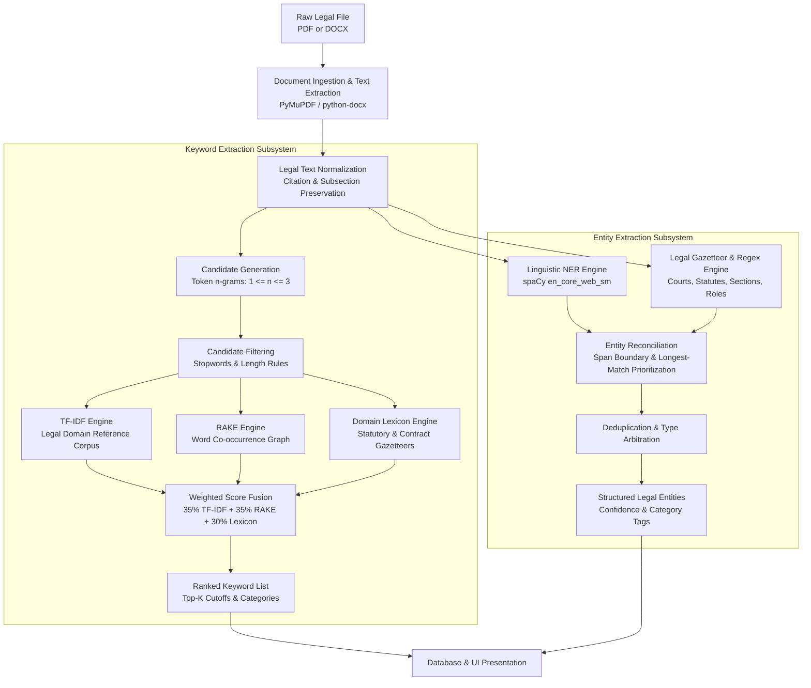

# LexExtract — NLP Pipeline Specification & Engineering Design

## 1. Pipeline Overview

The LexExtract Information Extraction pipeline converts raw, heterogeneous legal documents (PDF, DOCX) into structured, ranked legal concepts and typed named entities. The pipeline is designed around determinism, explainability, domain sensitivity, and zero-loss citation preservation.

---

## 2. Stage-by-Stage Processing Architecture

### Stage 1: Document Ingestion & Text Extraction
- **Input:** Raw binary byte stream of uploaded file (MIME type checked: `application/pdf` or `application/vnd.openxmlformats-officedocument.wordprocessingml.document`).
- **Processing:**
  - PDF: PyMuPDF (`fitz`) iterates through page streams, extracting text blocks with layout positioning.
  - DOCX: `python-docx` parses document XML, extracting paragraphs and structured tables.
- **Output:** Raw UTF-8 text string with structured per-page text arrays and computed metadata (SHA-256 hash, page count, word count).

### Stage 2: Normalization & Preprocessing
- **Input:** Raw extracted text.
- **Processing:**
  - Normalizes carriage returns (`\r\n` $\rightarrow$ `\n`) and collapses non-breaking spaces.
  - Collapses consecutive whitespace characters without altering legal paragraph boundaries.
  - Citation Safeguard: Unlike generic NLP normalizers that strip punctuation aggressively, LexExtract explicitly preserves parenthesis within statutory citations (e.g., `Section 11(6)` and `Article 226(1)`).
- **Output:** Cleaned text stream ready for linguistic tokenization.

### Stage 3: Keyword Candidate Generation & Filtering
- **Candidate Generation:**
  - Extracts unigrams, bigrams, and trigrams using whitespace and punctuation boundary markers.
  - Retains multi-word legal noun phrases (e.g., `liquidated damages`, `master services agreement`, `governing law`).
- **Candidate Filtering:**
  - Removes common English stopwords (e.g., `the`, `is`, `by`, `with`).
  - Filters terms shorter than 3 characters unless recognized as an acronym (e.g., `act`, `law`, `cpc`).
  - Legal vocabulary preservation: Prevents standard stopword lists from eliminating essential legal particles (e.g., `whereas`, `herein`, `pursuant to`).

### Stage 4: Tri-Model Keyword Scoring & Fusion
1. **TF-IDF Engine:**
   - Evaluates the local term frequency ($TF$) against an inverse document frequency ($IDF$) vector derived from standard legal document reference collections.
   - Accentuates discriminative concepts specific to the active document.
2. **RAKE Engine (Rapid Automatic Keyword Extraction):**
   - Constructs a word co-occurrence matrix across clause boundaries.
   - Calculates the degree-to-frequency ratio:
     $$\text{Score}_{\text{RAKE}}(w) = \frac{\text{deg}(w)}{\text{freq}(w)}$$
   - Accentuates cohesive multi-word phrases.
3. **Legal Lexicon Matcher:**
   - Matches candidate terms against a curated dictionary of 1,200+ Indian and Commonwealth legal terms across 7 distinct domains:
     - `Contract`: `indemnity`, `arbitration`, `termination`, `severability`
     - `Litigation`: `injunction`, `plaint`, `written statement`, `appellant`
     - `Statutory`: `penal code`, `limitation`, `negotiable instruments`
     - `Corporate`: `articles of association`, `fiduciary duty`, `resolution`
     - `Property`: `lessee`, `lessor`, `encumbrance`, `conveyance`
     - `IP`: `trademark`, `infringement`, `patent assignment`
     - `Constitutional`: `fundamental rights`, `writ petition`
   - Assigns a category and dictionary confidence boost.
4. **Hybrid Score Fusion:**
   $$\text{Final Score} = (0.35 \cdot S_{\text{TF-IDF}}) + (0.35 \cdot S_{\text{RAKE}}) + (0.30 \cdot S_{\text{Lexicon}})$$
   - Candidate scores are normalized into the range $[0.0, 1.0]$ and ranked descending.

---

### Stage 5: Hybrid Named Entity Recognition (NER)
1. **Linguistic Model:**
   - Employs `spaCy`'s statistical transition-based NER parser (`en_core_web_sm`) to detect general entities: `PERSON`, `ORG`, `GPE`, `DATE`, `MONEY`.
2. **Rule-Based Legal Gazetteer:**
   - Pattern matchers and regular expressions extract domain entities that standard linguistic models miss or misclassify:
     - **Courts:** `Supreme Court of India`, `High Court of [State]`, `District Court`, `National Company Law Tribunal (NCLT)`, `Debt Recovery Tribunal (DRT)`.
     - **Statutes:** `[Name] Act, [Year]`, `Indian Penal Code`, `Code of Civil Procedure`.
     - **Sections:** `Section \d+([A-Za-z])?(\(\d+\))?`, `Article \d+`.
     - **Case Numbers:** `W.P.(C) No. \d+/\d+`, `Company Petition No. \d+/\d+`.
     - **Legal Roles:** `Petitioner`, `Respondent`, `Appellant`, `Defendant`, `Plaintiff`, `Lessor`, `Lessee`, `Guarantor`.
     - **Monetary Values:** `Rs. [\d,]+`, `Rupees [\w\s]+ only`, `USD [\d,]+`.
     - **Jurisdiction:** `Seat of arbitration`, `place of jurisdiction`.
3. **Conflict Resolution & Deduplication:**
   - Overlapping spans are resolved via longest-match precedence (e.g., `High Court of Delhi at New Delhi` supersedes `Delhi`).
   - Rule-based legal categories override generic linguistic labels (e.g., `Supreme Court of India` is categorized as `COURT`, not generic `ORG`).
   - Normalizes text representations while retaining character offsets (`start_position`, `end_position`) for interactive viewer highlighting.

---

## 3. Pipeline Performance Characteristics

Based on live benchmarking across 12 legal documents (3,875 words):
- **Average Pipeline Execution Time:** 824.0 ms per document.
- **Text Normalization:** ~45 ms (5.5% of total time).
- **Keyword Scoring (Tri-Model Fusion):** ~210 ms (25.5% of total time).
- **Entity Extraction (spaCy + Legal Rules):** ~550 ms (66.7% of total time).
- **Zero Division Safety:** All metric computations enforce zero-denominator checks, ensuring mathematical stability with zero exceptions or NaN values.
