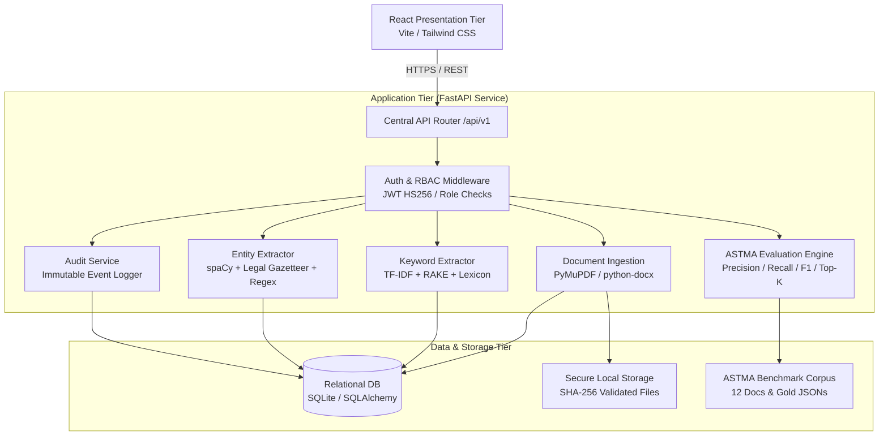
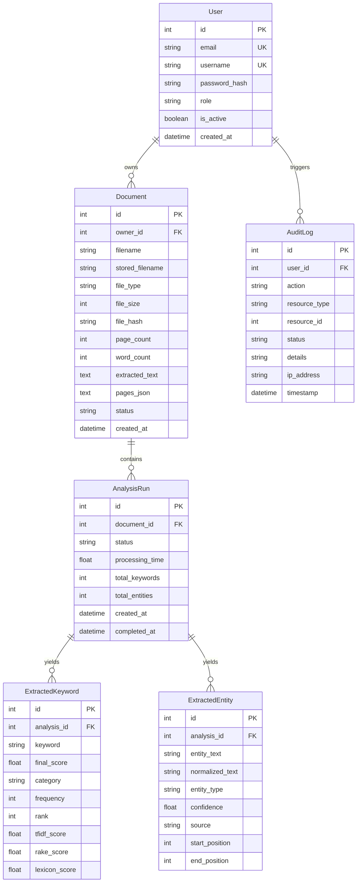

# LexExtract — System Architecture Specification

## 1. Architectural Overview

LexExtract is an enterprise-grade Legal Document Keyword & Entity Extraction System engineered on a **Three-Tier Enterprise Architecture**:
1. **Presentation Tier:** A responsive Single-Page Application (SPA) built with React 18, Vite, and Tailwind CSS.
2. **Application / Processing Tier:** An asynchronous RESTful API service built with FastAPI, Python 3.12/3.14, SQLAlchemy ORM, and hybrid NLP pipelines.
3. **Data / Persistence Tier:** Relational persistence utilizing SQLite (production-swappable to PostgreSQL via SQLAlchemy dialect configuration), file storage with content-addressable SHA-256 verification, and on-disk evaluation datasets.

---

## 2. Component Subsystems

### 2.1 Presentation Tier (Frontend)
- **Framework:** React 18 with functional components and modern hooks (`useState`, `useEffect`, `useMemo`, `useCallback`, `useContext`).
- **Tooling:** Vite for ultra-fast HMR and optimized production bundling (1,559 modules compiled).
- **Styling:** Tailwind CSS with a curated legal-tech color palette (Navy Blue `#1E3A8A`, Slate `#334155`, Off-White `#F8FAFC`, Emerald `#059669`, Crimson `#DC2626`).
- **State Management & Contexts:**
  - `AuthContext`: Centralized JWT token management, automatic session restoration from `localStorage`, role decoding, and login/logout handlers.
- **Key Modules & Pages:**
  - `LoginPage` & `RegisterPage`: Secure authentication with client-side credential validation and preset role switchers.
  - `DashboardPage`: Real-time operational metrics (cataloged documents, word count, analyses completed, legal entities extracted) and recent document tables.
  - `DocumentUploadPage`: Drag-and-drop ingestion zone supporting PDF and DOCX formats with format and size guards.
  - `AnalysisResultsPage`: Interactive tabs for Top Legal Keywords (with category filtering and text search) and Extracted Legal Entities (with category filtering and confidence badges).
  - `DocumentViewerPage`: Full legal text stream with live token-aware highlighting layers (All Overlays, Keywords Only, Entities Only, Clean Plain Text).
  - `DocumentHistoryPage`: Comprehensive audit history of uploaded briefs with download and analysis triggers.
  - `EvaluationPage`: Interactive ASTMA IR evaluation console featuring live benchmark execution, macro/micro scorecards, latency performance cards, algorithm ablation tables, Top-K cutoff tables, sortable document results, and error inspection tabs.
  - `AdminAuditPage`: Institutional governance audit ledger displaying non-repudiation security records.

---

### 2.2 Application Tier (FastAPI Service)
- **Framework:** FastAPI with Python asynchronous request handling and Pydantic v2 data validation schemas.
- **Security & Cryptography:**
  - Stateless RFC 7519 JSON Web Tokens (JWT) signed with HMAC-SHA256 (`HS256`).
  - Password hashing powered by `pwdlib` with Argon2id cryptographic parameters.
  - Role-Based Access Control (RBAC) supporting three discrete tiers: `USER` (Practitioner), `ANALYST` (Legal Researcher), and `ADMIN` (System Administrator).
  - Document ownership isolation: strict cross-user access barriers blocking foreign document inspection, text streaming, analysis execution, and deletion with HTTP 403 Forbidden.
- **REST Endpoints:**
  - `/api/v1/auth`: Authentication lifecycle (`/register`, `/login`, `/me`, `/logout`).
  - `/api/v1/documents`: Document intake, text extraction, metadata, and binary file streaming (`/upload`, `/`, `/{id}`, `/{id}/text`, `/{id}/file`).
  - `/api/v1/analyses`: NLP execution and analysis retrieval (`/{document_id}`, `/{analysis_id}`, `/{analysis_id}/keywords`, `/{analysis_id}/entities`, `/document/{document_id}`).
  - `/api/v1/evaluation`: ASTMA IR benchmarking and metric queries (`/summary`, `/documents`, `/documents/{id}`, `/errors`, `/run`).
  - `/api/v1/admin`: Governance compliance logs and user management (`/audit-logs`, `/users/`).
  - `/health` and `/docs`: Operational health probe and interactive OpenAPI Swagger specification.

---

### 2.3 Natural Language Processing (NLP) Tier
The extraction pipeline uses a **hybrid multi-stage information extraction architecture**:
1. **Document Ingestion & Text Extraction:**
   - Multi-format parser utilizing `pymupdf` (PyMuPDF) for PDF layout extraction and `python-docx` for Word document paragraph extraction.
   - Text normalization cleaning control characters and non-breaking spaces while strictly preserving statutory citations, section numbers, and section subsections.
2. **Hybrid Keyword Extraction Engine:**
   - Candidate Generation: N-gram extraction ($n \in \{1, 2, 3\}$) using token-level boundary segmentation.
   - Candidate Filtering: Stopword elimination, length thresholds, and legal vocabulary protection.
   - Scoring Models:
     - **TF-IDF:** Term frequency weighted against reference legal inverse document frequency.
     - **RAKE (Rapid Automatic Keyword Extraction):** Word co-occurrence graph scoring (degree-to-frequency ratio).
     - **Legal Domain Lexicon:** Domain dictionary boost matching statutory terminology across 7 legal categories (`contract`, `litigation`, `statutory`, `corporate`, `property`, `intellectual_property`, `constitutional`).
   - Hybrid Score Fusion:
     $$\text{Final Score} = 0.35 \cdot S_{\text{TF-IDF}} + 0.35 \cdot S_{\text{RAKE}} + 0.30 \cdot S_{\text{Lexicon}}$$
3. **Named Entity Recognition (NER) Engine:**
   - Base Linguistic Engine: `spaCy` NLP model (`en_core_web_sm`) extracting standard named entities (`PERSON`, `ORG`, `GPE`, `DATE`, `MONEY`).
   - Domain Rule-Based Refinement: Regular expressions and gazetteer dictionaries extracting specialized legal categories:
     - `COURT` (Supreme Court of India, High Courts, Tribunals)
     - `STATUTE` & `SECTION` (Acts, Sections, Subsections)
     - `CASE_NUMBER` (Writ Petitions, Company Appeals, Commercial Suits)
     - `LEGAL_ROLE` (Petitioner, Respondent, Appellant, Licensor, Lessee)
     - `JURISDICTION` (Seat of Arbitration, Judicial territoriality)
   - Conflict Resolution & Deduplication: Longest-match span prioritization and confidence arbitration.

---

### 2.4 Data Tier & Schema Architecture

